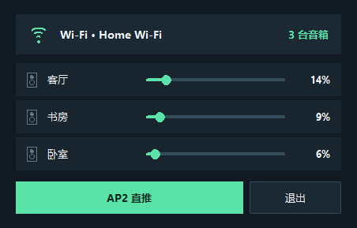

# 小米全屋播放 · Xiaomi Room Audio

**把 Windows 的声音送到全屋音箱。** 在电脑上照常看视频、听歌，用 Windows 音量键控制整屋，再用每台音箱的滑杆调好各个房间的音量。

[下载 0.6.1 预览版](https://github.com/chinayuli888-hash/xiaomi-room-audio/releases/tag/v0.6.1-preview) · [使用说明](USAGE.md) · [版本说明](CHANGELOG.md) · [验收摘要](docs/VALIDATION-0.6.1.md) · [来源核查](docs/PROVENANCE.md)

**0.6.1 预览版新增实时搜索**：不再要求手填 IP，换网后清空旧列表。升级后请重新安装 `requirements.txt` 中的依赖。[历史 0.6 下载包](https://github.com/chinayuli888-hash/xiaomi-room-audio/releases/tag/v0.6.0-preview) 保留原来的手动配置行为，未作修改。

## 主要功能

| 功能 | 用起来是什么样 |
| --- | --- |
| 一键搜索本地音箱 | 启动时自动搜索，也可手动重搜，不用填写 IP。列表来自当前网卡同子网、具备 AirPlay 2 能力且 TCP 可达的设备。 |
| 一键投放 | 点「AP2 直推」后再次全新搜索，再连接本轮找到的音箱，投放 Windows 默认媒体输出的声音。搜索本身不会开始播放。 |
| 独立调节 | 左右拖动每台音箱的滑杆。客厅响一点、卧室轻一点，互不影响。 |
| 总音量按比例联动 | 调 Windows 音量键或任务栏音量，三台按原比例一起增减；静音后再恢复，音量比例仍在。 |
| 低音量起播 | 起播最多 10%，保留系统原有的静音状态。每台音箱可配置自己的音量上限。 |
| 托盘播放 | 最小化留在任务栏；点「×」收进托盘，播放继续；点「退出」停止投放并恢复原来的 Windows 播放输出。 |
| 一眼看到连接状态 | 面板显示当前 Wi-Fi、音箱名称和在线数量。 |
| 换网清空旧连接 | Wi-Fi 或本机 IPv4 变化后，按正常流程停止旧投放、恢复电脑输出、清空旧列表并重新搜索；新网络不会自动开始播放。 |

界面示例：演示名称与音量，不代表一次在线会话。实时搜索流程见使用说明。

## 快速上手

1. 准备一台 Windows 10/11 电脑、64 位 Python 3.12（含 Tk）、VB-CABLE 和支持 DirectShow 的 FFmpeg。
2. 在当前源码目录打开 PowerShell，运行 `py -3.12 -m pip install -r requirements.txt`。复制 `settings.example.json` 为 `settings.json`，设置 FFmpeg 路径或使用 `bin/ffmpeg.exe`；不用填写音箱 IP。
3. 双击 `小米全屋播放.vbs`，等待自动搜索；需要时点「一键搜索本地音箱」。确认设备后点「AP2 直推」，应用会重新扫描再连接。试完后，从窗口或托盘选「退出」。

一次最多播放 8 台。若当前网络发现超过 8 台，应用会提示减少设备数量，不会自行选前 8 台。设备名称和校准按稳定设备身份保存在本机私有档案中；旧 `hosts` 配置只作兼容，不用于选择投放对象。新设备的接收音量上限默认为 −12 dB。

第一次配置、调整接收音量、切回电脑扬声器等步骤见 [完整使用说明](USAGE.md)。源码预览不附带 Python、FFmpeg 或虚拟声卡驱动。

## 已经实测

- **0.6.1 验收**：50 项自动化测试通过；当前网络三台音箱保持三路连接连续 60 秒，并复核了系统音量比例联动和退出恢复。真实切换 Wi-Fi 尚未做现场试验，本次也未重新录音测延迟。采集队列仍有丢弃记录，不能保证零丢帧。详见 [0.6.1 验收摘要](docs/VALIDATION-0.6.1.md)。
- **三台联播**：小米 Sound 黑、小米 Sound 白和 Xiaomi Sound Pro 在同一局域网内正常联播。发送端使用同一时间线；尚未逐台测量声音到达时间差。
- **延迟**：早期 Windows 预览版，从虚拟声卡采集到电脑内麦拾音，中位数约 **0.69 秒**。结果受网络、音箱和房间影响。
- **比例联动**：在 0.6，Windows 从 **5% → 10% → 5%**，黑色、Pro、白色三路发送幅度分别对应 **4:5:3 → 8:10:6 → 4:5:3**。这项验证的是发送端幅度。
- **黑白两台的音量空间**：0.6 可为各台分别设置接收音量上限。将两台 Sound 的设置从 −12 dB 改到 0 dB 后，在同样 20% 滑杆设置下，电脑内麦的扫频录音分别测到约 **+13.1 dB** 和 **+12.6 dB**。其他设备默认仍为 −12 dB，实测配置不会自动套用。

## 支持范围

当前是独立开发的 **Windows 0.6.1 预览版**，与小米和 Apple 官方无关。电脑和音箱需在同一局域网；自动发现限定当前活动网卡的 IPv4 子网，一次投放 1–8 台，播放实测范围是上述三台小米音箱。投放使用 AirPlay 2，不通过 AirDrop 或蓝牙。已有蓝牙设备仍可按 Windows 原来的方式使用。

组合发布采用 [GPL-3.0](LICENSE)。第三方原有的 MIT、Apache-2.0 和 BSD 声明均随源码保留；详细的上游版本、改编关系和来源证据见 [来源核查](docs/PROVENANCE.md) 和 [第三方许可说明](THIRD_PARTY.md)。
