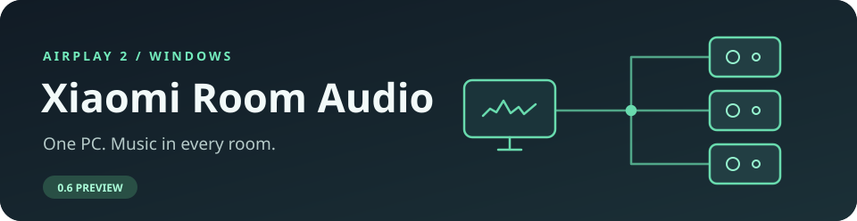

# 小米全屋播放 · Xiaomi Room Audio

**把 Windows 的声音送到全屋音箱。** 在电脑上照常看视频、听歌，用 Windows 音量键控制整屋，再用每台音箱的滑杆调好各个房间的音量。

[使用说明](USAGE.md) · [版本说明](CHANGELOG.md) · [第三方许可说明](THIRD_PARTY.md)

## 主要功能

| 功能 | 用起来是什么样 |
| --- | --- |
| 一键投放 | 点绿色按钮，把走 Windows 默认媒体输出的声音送到同一局域网内的 AirPlay 2 音箱。 |
| 独立调节 | 左右拖动每台音箱的滑杆。客厅响一点、卧室轻一点，互不影响。 |
| 总音量按比例联动 | 调 Windows 音量键或任务栏音量，三台按原比例一起增减；静音后再恢复，音量比例仍在。 |
| 低音量起播 | 起播最多 10%，保留系统原有的静音状态。每台音箱可配置自己的音量上限。 |
| 托盘播放 | 最小化留在任务栏；点「×」收进托盘，播放继续；点「退出」停止投放并恢复原来的 Windows 播放输出。 |
| 一眼看到连接状态 | 面板显示当前 Wi-Fi、音箱名称和在线数量。 |

## 快速上手

1. 准备一台 Windows 10/11 电脑、64 位 Python 3.12（含 Tk）、VB-CABLE 和支持 DirectShow 的 FFmpeg。
2. 在项目目录打开 PowerShell，运行 `py -3.12 -m pip install -r requirements.txt`。复制 `settings.example.json` 为 `settings.json`，填写音箱的 IPv4 地址。
3. 双击 `小米全屋播放.vbs`，点「AP2 直推」。试完后，从窗口或托盘选「退出」。

第一次配置、调整接收音量、切回电脑扬声器等步骤见 [完整使用说明](USAGE.md)。源码预览不附带 Python、FFmpeg 或虚拟声卡驱动。

## 已经实测

- **三台联播**：小米 Sound 黑、小米 Sound 白和 Xiaomi Sound Pro 在同一局域网内正常联播。发送端使用同一时间线；尚未逐台测量声音到达时间差。
- **延迟**：早期 Windows 预览版，从虚拟声卡采集到电脑内麦拾音，中位数约 **0.69 秒**。结果受网络、音箱和房间影响。
- **比例联动**：在 0.6，Windows 从 **5% → 10% → 5%**，黑色、Pro、白色三路发送幅度分别对应 **4:5:3 → 8:10:6 → 4:5:3**。这项验证的是发送端幅度。
- **黑白两台的音量空间**：0.6 可为各台分别设置接收音量上限。将两台 Sound 的设置从 −12 dB 改到 0 dB 后，在同样 20% 滑杆设置下，电脑内麦的扫频录音分别测到约 **+13.1 dB** 和 **+12.6 dB**。其他设备默认仍为 −12 dB，实测配置不会自动套用。

## 支持范围

当前是独立开发的 **Windows 0.6 预览版**，与小米和 Apple 官方无关。电脑和音箱需在同一局域网，本版手动配置 1–8 台，当前只验证了上述三台小米音箱。投放使用 AirPlay 2，不通过 AirDrop 或蓝牙。已有蓝牙设备仍可按 Windows 原来的方式使用。

本仓库用于私有预览。应用许可证和 AirPlay 发送模块的来源审核尚未完成；第三方信息见 [许可说明](THIRD_PARTY.md)。
